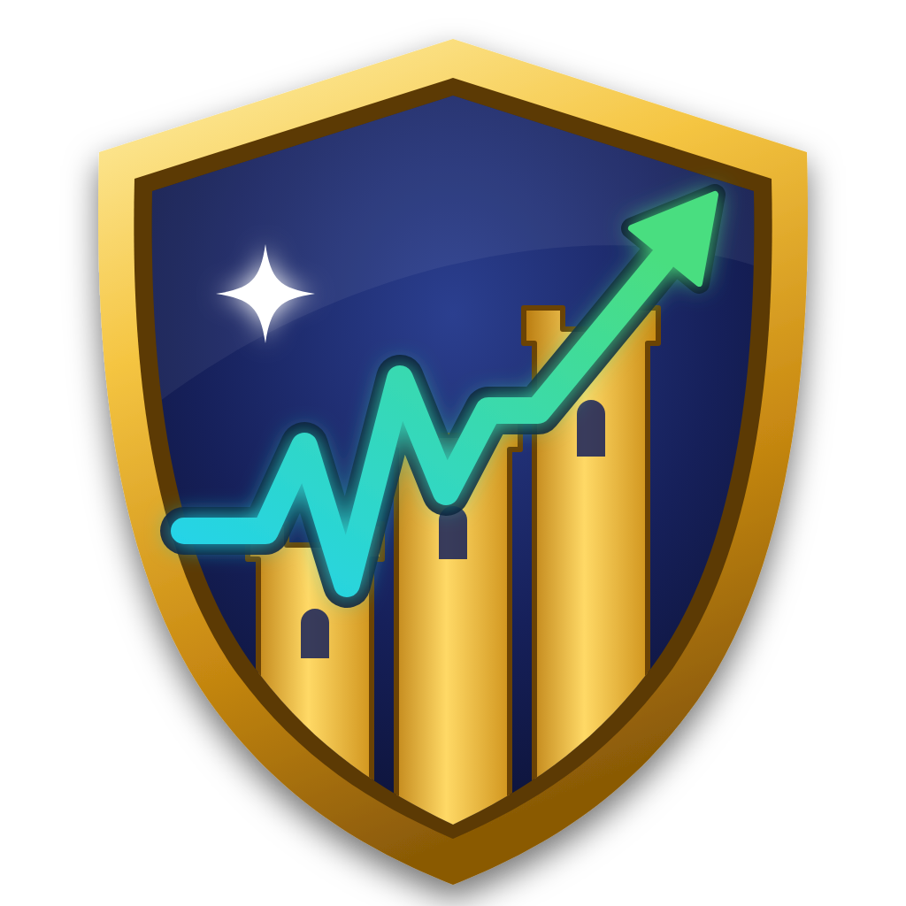
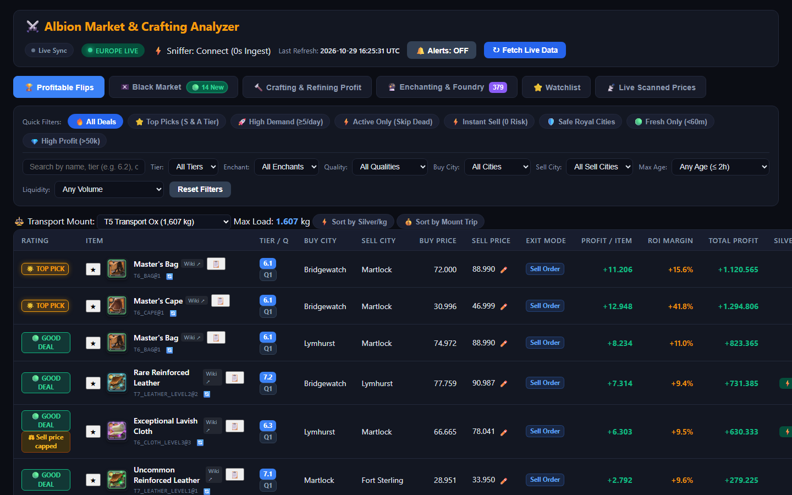
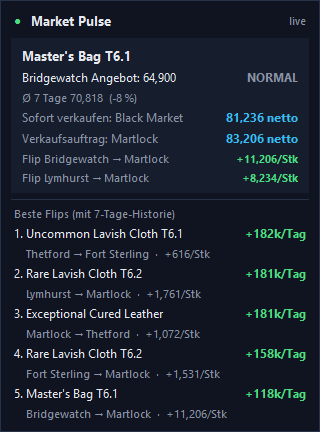
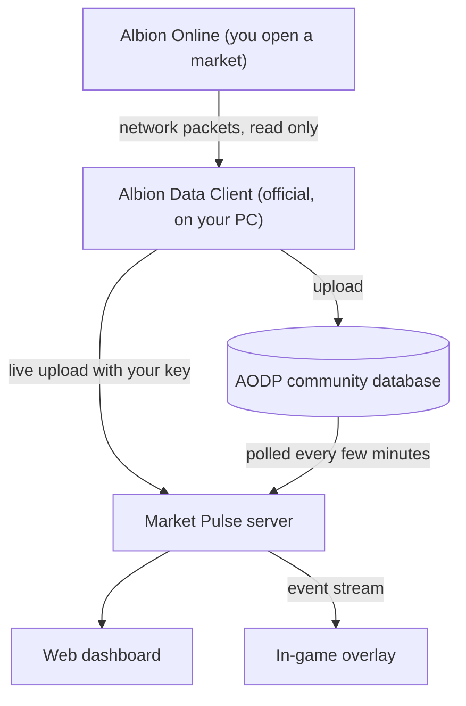

<div align="center">



# Albion Market Pulse

**Market intelligence for Albion Online: profitable flips, crafting and Black Market deals,
checked against real trade history, on your dashboard and right inside the game.**

<p>
  
  
  
  
  
</p>

<a href="docs/images/dashboard.png"></a>

[Features](#features) · [How it works](#how-it-works) · [Getting started](#getting-started) ·
[Is this allowed?](#is-this-allowed) · [Docs](#documentation) · [FAQ](#faq)

</div>

---

Every day thousands of players feed market prices into the community
[Albion Online Data Project](https://www.albion-online-data.com/). Albion Market Pulse turns that
stream into decisions: **what to buy where, where to sell it, and how much you really keep** after
tax, setup fee and a realistic share of the market.

Run it on your own PC, or on a small Linux server that keeps polling around the clock. Your
dashboard is then up to date even while nobody is playing.

## Features

### Find the trade

- **City flips and Black Market arbitrage** across all Royal cities, Caerleon and the Black Market,
  with a freshness filter for orders that appeared minutes ago.
- **Crafting, focus crafting and refining** with city return-rate bonuses and station fees.
- **Enchanting** with exact rune, soul and relic counts for every item slot and a batch simulator.
- **Transport planning**: silver per kg and full-trip profit for your mount, from T3 ox to grizzly.
- **Price history** for any item: daily trade prices per city for up to 120 days, and the order book
  of the last 7 days (server mode).
- **Price alerts**: get a desktop notification and an in-game banner when an item drops below or a
  buy order rises above your price (server mode).
- **Order tracker**: your buy and sell orders with fees, stock, average cost and profit, plus a
  warning in the dashboard and in game as soon as somebody outbids you (server mode).
- **Island and gathering**: profit per day for every crop, herb and farm animal (seed return,
  watering focus, offspring, cheapest food) and silver per hour for gathering and fishing, with the
  zones near your home city (server mode).
- **One-click copy** of the in-game search name, plus a personal watchlist.

### Trust the numbers

- **Bait-price detection**: a buy price far below the 7-day average or a contradictory order book
  is replaced by a realistic price instead of producing a fake million-silver flip.
- **Spike protection**: sell prices are capped at 110 % of the 7-day average, and at 150 % of the
  other cities' median when a city has no history.
- **Realistic daily profit**: based on a 10 % share of the real daily volume, not all of it.
- **Verified first**: flips without any trade history are labelled and ranked after verified ones.

### See it in game



- **In-game overlay**: open an item at the market and a card appears over the game. It shows the
  price against the 7-day average (cheap, fair or expensive) and the best city to sell instantly or
  with an order, net after tax.
- **Top flips at a glance**, refreshed after every server sweep.
- Shows only while Albion is in front, never takes a click or focus away from the game.
  Ctrl+Shift+O hides it, Ctrl+Shift+L moves it.
- **Live prices in seconds**: your own market visits reach your dashboard immediately through the
  official Albion Data Client.

<br clear="right">

### Run it your way

| | Desktop | Linux server |
| --- | --- | --- |
| Where | your PC, native window or `localhost` | any Debian/Ubuntu box, behind HTTPS |
| Prices | while the app is open | 24/7, rate-limited to AODP's fair-use limits |
| History | AODP's window | own SQLite history (120 days), price charts and alerts |
| Access | only you | login link, optional read-only sharing |
| Live client and overlay | local Data Client | `AlbionMarketPulseClient.exe` on any PC |

## How it works



The server combines two sources. **AODP** provides prices from every player, so the dashboard keeps
moving without you. **Your own Data Client** adds your market visits within seconds. Each sweep
is stored in SQLite, so the bait and spike checks can compare every price with its 7-day average.

## Getting started

### Option 1: Linux server and Windows client (recommended)

```bash
git clone -b linux-server https://github.com/MinosCodes/albion-market-pulse.git
cd albion-market-pulse
sudo ./deploy/linux/install.sh
```

The installer creates a hardened systemd service and a config with fresh keys. Put a reverse proxy
with HTTPS in front ([Caddy example](deploy/linux/Caddyfile.example)), then print your links:

```bash
cd /opt/albion-pulse && sudo -u albion-pulse venv/bin/python -m albion_flips.server \
  --config /etc/albion-pulse/config.json --show-links
```

On your gaming PC:

1. Install [Npcap](https://npcap.com/#download) with *WinPcap API-compatible mode*.
2. Download `AlbionMarketPulseClient.exe` from the
   [releases](https://github.com/MinosCodes/albion-market-pulse/releases) and check it against its
   `.sha256` (or build it: `pyinstaller client/windows/pulse_client.spec`).
3. Paste the pairing link and click **Save and start**. Tick **Show the in-game overlay** if you
   want the overlay, and run Albion in *windowed* or *borderless window* mode.

### Option 2: Desktop only

```bash
git clone https://github.com/MinosCodes/albion-market-pulse.git
cd albion-market-pulse
python -m venv .venv
.venv\Scripts\activate            # macOS/Linux: source .venv/bin/activate
pip install -r requirements.txt
python run_desktop.py                            # or: python -m albion_flips.cli --watch --web
```

On Windows, `Setup-Windows.bat` does all of this and creates a desktop shortcut.
Details: [docs/DESKTOP.md](docs/DESKTOP.md).

## Is this allowed?

Albion Market Pulse follows the rule Sandbox Interactive's technical lead gave for the Albion Data
Project:

> "As long as you just look and analyze we are ok with it."
> — MadDave, Technical Lead, Albion Online

So the project:

- **never** reads or writes game memory, injects code or hooks the game client,
- **never** sends input to the game: no bots, macros or automation,
- captures market traffic only through the official, open-source
  [Albion Data Client](https://github.com/ao-data/albiondata-client), like every AODP contributor,
- draws the overlay as an ordinary always-on-top window, not inside the game.

## Documentation

| Topic | |
| --- | --- |
| Linux server: setup, design decisions, security model, overlay API | [docs/LINUX_SERVER.md](docs/LINUX_SERVER.md) |
| Desktop mode, command line options, dashboard guide, `config.json` reference | [docs/DESKTOP.md](docs/DESKTOP.md) |
| Original specification | [docs/SPEC.md](docs/SPEC.md) |

## FAQ

<details>
<summary><b>Why do some flips say "no history"?</b></summary>

AODP has no trades for that item in that city during the last days, so the price cannot be
checked against an average. These flips are ranked after verified ones and never appear in the
overlay's top list.
Treat them as leads, not as safe profit.
</details>

<details>
<summary><b>The overlay does not appear.</b></summary>

Run Albion in *windowed* or *borderless window* mode. In exclusive fullscreen the game owns the
screen and no ordinary window can be drawn over it. Also check that the game window is in front.
Ctrl+Shift+O toggles the overlay.
</details>

<details>
<summary><b>Do I have to keep my PC running?</b></summary>

No. The server polls AODP on its own. Your PC only adds your own market visits faster.
</details>

<details>
<summary><b>Can friends use my server?</b></summary>

Yes. Set `public_read` to share a read-only dashboard, or give them the pairing link so their market
visits also reach your server. Without the key nobody can upload prices.
</details>

<details>
<summary><b>Is my key safe in the .exe?</b></summary>

The release contains no key, only an optional default server address. The key is entered once,
sent only over HTTPS and stored in your user profile.
</details>

## Development

```bash
pip install -r requirements.txt
pytest -q          # profit math, robust prices, server auth, live client, overlay feed
```

```
albion_flips/      analysis engine, web dashboard, server mode, overlay feed
client/windows/    live client and in-game overlay (PyInstaller build)
deploy/linux/      installer, systemd unit, Caddy example
docs/              guides and design notes
tests/             pytest suite with offline fixtures
```

Releases are built by [`.github/workflows/windows-client.yml`](.github/workflows/windows-client.yml):
tests, a Windows build and a SHA-256 file attached to every GitHub release.

## Acknowledgements

- [Albion Online Data Project](https://www.albion-online-data.com/) for the community price data
- [ao-data/albiondata-client](https://github.com/ao-data/albiondata-client) for the official data client
- [Npcap](https://npcap.com/) for packet capture on Windows

Albion Market Pulse is a fan project and is not affiliated with or endorsed by Sandbox Interactive.
Albion Online is a trademark of Sandbox Interactive GmbH.
